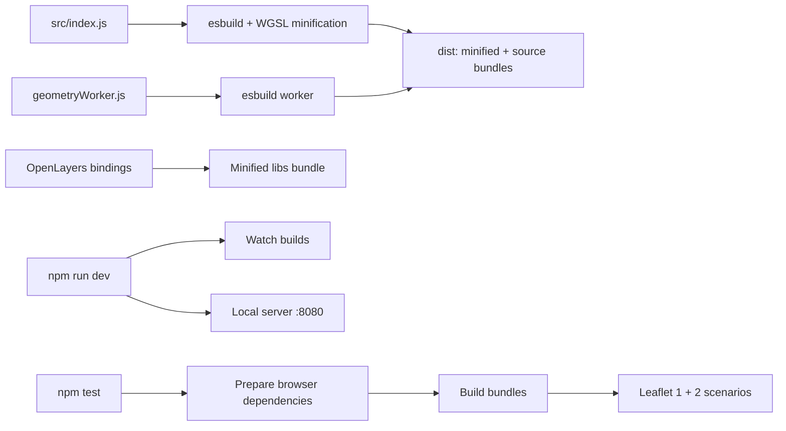
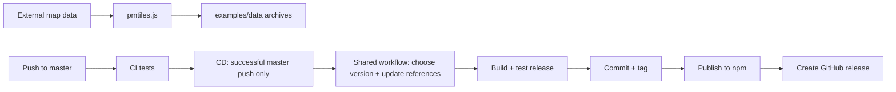

# Build tooling

[Project README](../README.md) | [Source guide](../src/README.md) | [Test guide](../test/README.md)

## Build and development

[build.js](./build.js) also produces source maps; WGSL minification applies to
annotated shader templates in the minified main bundle.
[dev.js](./dev.js) watches builds and starts [server.js](./server.js), which
serves local files and byte ranges. With `watch: true`, the server rewrites this
package's CDN URLs to local paths in HTML responses without changing examples
on disk. Smoke tests enable the same mode and check that plugin assets stay local.
See [test.js](./test.js) and the
[test guide](../test/README.md) for scenario selection and version differences.

## Data and releases

`npm run pmtiles` downloads and writes demo data; use `--only`, `--bbox`,
`--jobs` or `--out-dir` to constrain a run. `node build/pmtiles.js --self-test`
checks archive generation without rebuilding the demo data. The Colosseum
builder removes legacy TIFF assets after publishing the combined archive.

The [CI workflow](../.github/workflows/ci.yml) runs tests on pushes and pull
requests. After a successful CI run for a push to `master`, the
[CD workflow](../.github/workflows/cd.yml) calls the
[shared workflow](https://github.com/Raruto/Raruto/blob/master/.github/workflows/cd.yml)
with the tested commit and branch. The shared workflow checks that commit is
still at the branch tip and tests the prepared release before publishing.
It serializes release jobs and atomically pushes the release commit and tag. If `master` advances
during testing, the push fails rather than overwriting work; if it advanced
before the release job started, that job skips the old push. The newer push's
workflow can release the combined changes. Already released commits are
skipped, so overlapping pushes may share a release. A push containing several
commits also produces one release. GitHub queues at most 100 pending release
jobs; further jobs are canceled.

The GitHub release notes list commit subjects since the previous tag, oldest
first (including the release commit), before GitHub's generated notes and Full
Changelog link.

The shared workflow gives `[major]` precedence over
`[minor]` across commit messages since the previous tag; otherwise it increments
patch. Patch and minor carry after 9, including for an explicit minor increment.
This intentionally differs from SemVer's unbounded numbers. The release commit
updates `package.json`, its lockfile, tracked versioned package references,
and tracked build output. The updater lives in the shared workflow and fails
if it finds no versioned package references. The release commit does not trigger a
second workflow because it uses `GITHUB_TOKEN`. Local `npm version` changes
fail in the `preversion` hook; the shared workflow explicitly uses
`--ignore-scripts` to bypass that hook. This flag can also bypass the guard
locally. Running `npm version` without arguments only displays versions.

Before enabling the workflow, configure the npm package's
[trusted publisher](https://docs.npmjs.com/trusted-publishers/) for GitHub
Actions: owner `Raruto`, repository `leaflet-city-mapper`, workflow `cd.yml`
(the caller, not the shared workflow),
and allow direct `npm publish`. The release job uses Node 24 and `id-token:
write`; GitHub Actions also needs permission to push to `master` and create
tags. Branch protection must permit the bot's release commit. Configure these
before pushing the workflow. Publish the shared workflow to
`Raruto/Raruto`'s `master` branch before pushing the calling workflow. The
`@master` reference
tracks future changes to that repository; pin a reviewed commit SHA instead if
the release workflow should not change automatically. A new npm
trusted-publisher configuration expires if it does not complete its first
publication within two days.

If publication fails after the atomic push, the tag remains and later releases
stop until its GitHub release exists. Check the failed job and npm registry:
from a clean checkout of that tag, publish the tagged package only if its
version is not already on npm, then recreate the GitHub release from the same
tag range and commit list used by the shared workflow. npm versions are
immutable; investigate any existing version rather than overwriting it. If the
atomic push failed, no tag was pushed: rerun the failed job or let the next
successful push release the pending commits.
