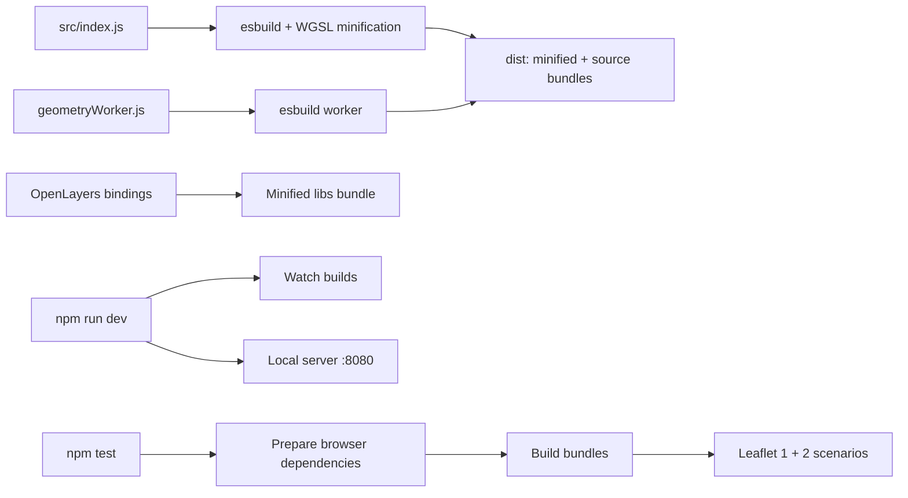
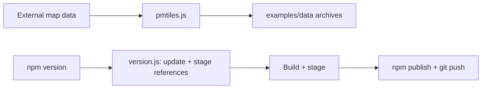

# Build tooling

[Project README](../README.md) | [Source guide](../src/README.md) | [Test guide](../test/README.md)

## Build and development

[build.js](./build.js) also produces source maps; WGSL minification applies to
annotated shader templates in the minified main bundle.
[dev.js](./dev.js) watches builds and starts [server.js](./server.js), which
serves local files and byte ranges. See [test.js](./test.js) and the
[test guide](../test/README.md) for scenario selection and version differences.

## Data and releases

`npm run pmtiles` downloads and writes demo data; use `--only`, `--bbox`,
`--jobs` or `--out-dir` to constrain a run. `node build/pmtiles.js --self-test`
checks archive generation without rebuilding the demo data. The Colosseum
builder removes legacy TIFF assets after publishing the combined archive.

The npm version lifecycle can request authentication, stage files, publish and
push. Do not run it as a routine build or test. See [package.json](../package.json)
and [version.js](./version.js) for the exact commands.
