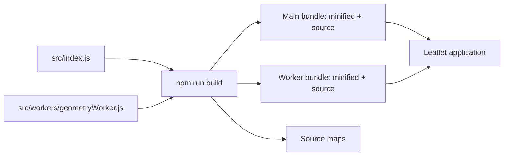

# Distribution bundles

[Project README](../README.md) | [Build guide](../build/README.md) | [Source guide](../src/README.md)

These are tracked build outputs, not the source of truth. Edit [src](../src/README.md)
and regenerate with [build.js](../build/build.js), rather than hand-editing
bundles. The main entry is configured in [package.json](../package.json).
