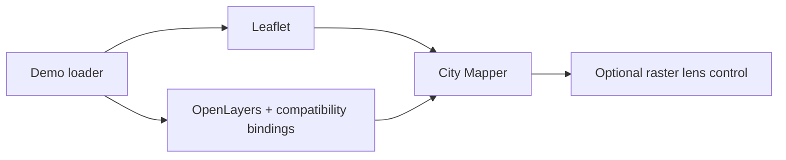

# Example and compatibility helpers

[Project README](../README.md) | [Examples](../examples/) | [Build guide](../build/README.md)

[leaflet.js](./leaflet.js) is a demo loader, not required by applications.
[openlayers-bindings.js](./openlayers-bindings.js) supplies Leaflet-compatible
classes backed by OpenLayers; its minified bundle is generated by
[build.js](../build/build.js). [leaflet-lens.js](./leaflet-lens.js) adds an
optional control for comparing two raster layers.
