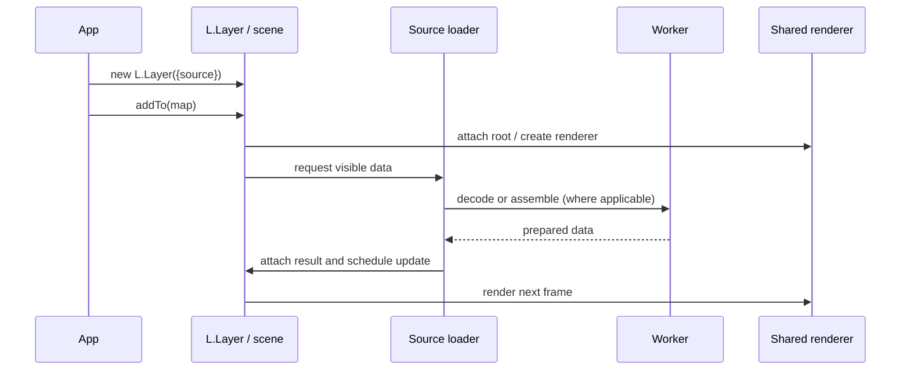
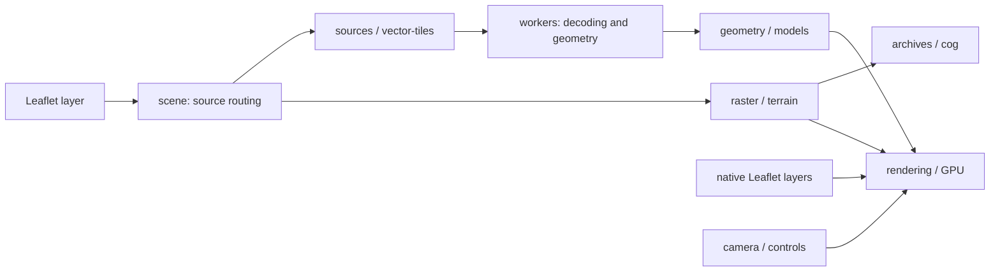

# Source guide

[Project README](../README.md) | [Entry point](./index.js)

Internal architecture and contributor navigation. For the public API, see the
[project README](../README.md).

## From a layer to a frame



Not every source uses this exact worker path: vector tiles have their own
loading and presentation lifecycle, and a native Leaflet layer is synchronized
through [native](./native/README.md). See [scene](./scene/README.md) for source
routing, shared ownership and removal.

## Ownership and debugging

[weakmaps](./weakmaps/README.md) holds per-object state;
[globals](./globals/README.md) also contains shared scratch buffers and queues.
On source failures, inspect the layer's `error` and `progress` events.

## Where to start a change

| Change | Follow the code | Existing scenarios |
| --- | --- | --- |
| Source routing or scene ownership | [scene](./scene/README.md) → relevant source guide → [workers](./workers/README.md) | [scene](../test/features/scene.feature), [workers](../test/features/workers.feature) |
| GeoJSON extrusions or feature hits | [sources](./sources/README.md) → [geometry](./geometry/README.md) → [picking](./picking/README.md) | [geojson](../test/features/geojson.feature), [picking](../test/features/picking.feature) |
| Tile formats or terrain | [archives](./archives/README.md) / [cog](./cog/README.md) → [raster](./raster/README.md) / [terrain](./terrain/README.md) | [pmtiles](../test/features/pmtiles.feature), [cog](../test/features/cog.feature), [terrain](../test/features/terrain.feature) |
| Vector tile styles and labels | [mvt](./mvt/README.md) → [vector-style](./vector-style/README.md) → [vector-tiles](./vector-tiles/README.md) | [vector tiles](../test/features/vector-tiles.feature), [unit cases](../test/features/vector-tile-unit.feature) |
| Camera or walking | [camera](./camera/README.md) / [controls](./controls/README.md) → [walk](./walk/README.md) / [collision](./collision/README.md) | [camera](../test/features/camera.feature), [walk](../test/features/walk.feature) |
| GPU drawing or lighting | [rendering](./rendering/README.md) → [materials](./materials/README.md) / [shaders](./shaders/README.md) → [lighting](./lighting/README.md) / [shadows](./shadows/README.md) | [webgpu](../test/features/webgpu.feature), [night lights](../test/features/night-lights.feature), [sunlight](../test/features/sunlight.feature) |

The [build guide](../README.md#build-guide) explains the normal build and test
commands. The test runner builds and runs Cucumber with both Leaflet versions;
the feature files above are useful starting points for finding behavior and
regressions specific to a change.

## Subsystem map

This diagram is an overview, not an exhaustive dependency graph.



## Source layout

```text
src/
  index.js           Public entry point and source registration
  globals/           One shared constant or mutable cell per module
  weakmaps/          One private WeakMap per map/layer state field
  mvt/               PBF vector tile decoding and tessellation
  vector-style/      Safe vector style parsing and expressions
  vector-tiles/      Native vector tile lifecycle and worker preparation
  camera/            Leaflet camera API and scene camera state
  controls/          Compass, dragging, touch and resizing
  core/              Leaflet hooks, camera-aware overlays and readiness
  native/            Native Leaflet layers rendered through WebGPU
  layer-controls/    Layer entry placement and progress indicators
  scene/             Source routing, lifecycle and graph nodes
  sources/           GeoJSON and streamed source loading and assembly
  workers/           Geometry, MVT, COG and model tasks sharing one CDN-compatible worker
  picking/           Raycasting, highlighting and feature interaction
  rendering/         Frame stages, draw pipelines and mesh lifecycle
  gpu/               Device initialization, renderer resources and diagnostics
  materials/         Material programs, uniforms, glTF materials and cutouts
  textures/          Image loading, texture upload/binding and roof atlases
  animations/        Camera transitions, zoom synchronization and tile fading
  shadows/           Directional shadow maps and cache
  lighting/          Point lights and spatial light grids
  shaders/           Material shader generation
  geometry/          Mesh construction, bounds, grids, vectors and route geometry
  projections/       Map, screen and local coordinate conversion
  transforms/        Local/world matrices and glTF node transforms
  triangulation/     Polygon triangulation and ring operations
  collision/         Mesh intersection and collision queries
  models/            glTF loading, decoding and scene assembly
  archives/          PMTiles archive reading and decompression
  cog/               Supported GeoTIFF directories, byte ranges and tile decoding
  raster/            Raster tile loading, attachment and lifecycle
  traffic/           Routes, scheduling, simulation, loading and rendering
  vehicles/          Vehicle model geometry
  terrain/           Terrain loading and sampling
  astronomy/         Sun/moon position and observer/date validation
  sunlight/          Sky, celestial display and time controls
  walk/              First-person walking
  colors/            Colour parsing, conversion, interpolation and formatting
  utils/             Shared numeric and no-op helpers
```

## Layer lifecycle and data

- [scene](./scene/README.md): routing, attachment and shared scene lifecycle.
- [sources](./sources/README.md): GeoJSON and source area loading.
- [archives](./archives/README.md), [cog](./cog/README.md), [raster](./raster/README.md), [terrain](./terrain/README.md): archived data, raster imagery and elevation.
- [mvt](./mvt/README.md), [vector-style](./vector-style/README.md), [vector-tiles](./vector-tiles/README.md): vector tile decoding, styling and display.
- [models](./models/README.md), [workers](./workers/README.md): glTF loading and background jobs.
- [native](./native/README.md): GPU representation of native Leaflet layers.

## Rendering and geometry

- [gpu](./gpu/README.md), [rendering](./rendering/README.md), [materials](./materials/README.md), [shaders](./shaders/README.md), [textures](./textures/README.md): GPU resources and frame rendering.
- [geometry](./geometry/README.md), [triangulation](./triangulation/README.md), [transforms](./transforms/README.md), [projections](./projections/README.md): mesh construction and coordinate transformations.
- [lighting](./lighting/README.md), [shadows](./shadows/README.md), [colors](./colors/README.md): lighting, shadow maps and color conversion.
- [picking](./picking/README.md), [collision](./collision/README.md): interaction and collision queries.

## Map behavior

- [core](./core/README.md), [camera](./camera/README.md), [controls](./controls/README.md), [animations](./animations/README.md): Leaflet integration and camera interactions.
- [layer-controls](./layer-controls/README.md): layer control placement and status.
- [astronomy](./astronomy/README.md), [sunlight](./sunlight/README.md): celestial positions and time controls.
- [walk](./walk/README.md), [traffic](./traffic/README.md), [vehicles](./vehicles/README.md): walking, traffic simulation and model geometry.

## Shared state and helpers

- [globals](./globals/README.md): shared constants, descriptors and mutable cells.
- [weakmaps](./weakmaps/README.md): private state associated with maps, layers and other objects.
- [utils](./utils/README.md): small shared helpers.

Each source directory has a README; the source documentation test checks this
invariant for new directories as well.
