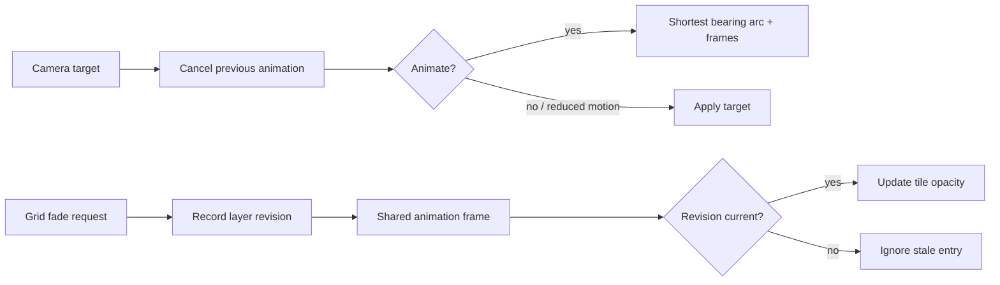

# Animations

[Source guide](../README.md) | [Project README](../../README.md)

Schedules camera transitions, zoom synchronization, marker panning and grid tile fades.
Shared queues allow multiple layers or maps to use the same animation frame.

## Timing and cancellation

Zoom synchronization has its own intermediate view:
[synchronizeZoomView.js](./synchronizeZoomView.js).

- [mapAnimateCamera.js](./mapAnimateCamera.js): start a camera transition.
- [runGridFades.js](./runGridFades.js): advance queued tile fades only for current revisions.
- [synchronizeZoomView.js](./synchronizeZoomView.js): coordinate map zoom animations with the scene.

Related: [camera](../camera/README.md), [core](../core/README.md), [rendering](../rendering/README.md).
