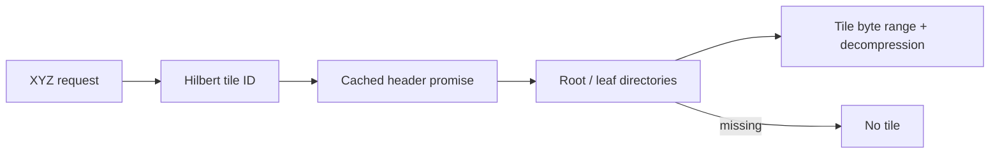

# Archives

[Source guide](../README.md) | [Project README](../../README.md)

Reads PMTiles headers, directories and tile byte ranges, including decompression
and cached directory lookups.

## Tile lookup

An external provider can implement `getHeader` and `getZxy`. Range reads
validate length and ETag; changed archives fail rather than mixing versions.
Traversal rejects cycles, invalid leaves and excessive nesting. For GeoJSON,
[loadSource.js](./loadSource.js) accepts inline data or a URL, but not both.

- [getHeader.js](./getHeader.js): obtain an archive header.
- [getZxy.js](./getZxy.js): look up a tile by zoom, column and row.
- [decodeDirectory.js](./decodeDirectory.js): decode directory entries.

Related: [cog](../cog/README.md), [sources](../sources/README.md), [raster](../raster/README.md).
