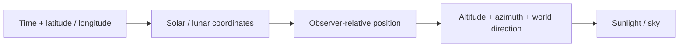

# Astronomy

[Source guide](../README.md) | [Project README](../../README.md)

Calculates celestial positions and solar time for a date and observer.

## From observer to direction

Output angles are degrees; internal trigonometry uses radians. Solar position
does not include atmospheric refraction. The clock belongs to
[sunlight](../sunlight/README.md), not these calculations.

- [solarPosition.js](./solarPosition.js) and [moonPosition.js](./moonPosition.js): celestial coordinates.
- [horizontalPosition.js](./horizontalPosition.js): observer-relative position.
- [solarTime.js](./solarTime.js): solar time calculation.

Related: [sunlight](../sunlight/README.md).
