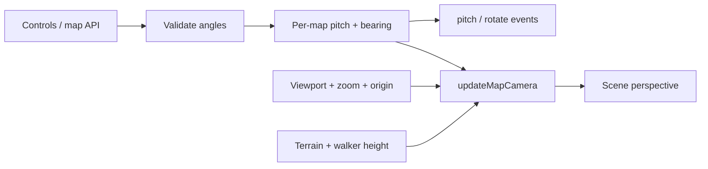

# Camera

[Source guide](../README.md) | [Project README](../../README.md)

Extends map behavior for pitch and bearing and updates the scene camera to match
the Leaflet view. Camera-aware bounds and pan operations live here as well.

## Map state versus scene camera

Pitch is clamped and bearing normalized. The rendering camera is derived from
map state, including intermediate zoom views; elevated geometry uses the GPU
camera, not a CSS transform. Ground conversion lives in
[projections](../projections/README.md).

- [mapCamera.js](./mapCamera.js): install camera-related map integration.
- [mapSetPitchAndBearing.js](./mapSetPitchAndBearing.js): validate and update camera angles.
- [updateMapCamera.js](./updateMapCamera.js): synchronize the rendering camera.

Related: [controls](../controls/README.md), [projections](../projections/README.md), [animations](../animations/README.md).
