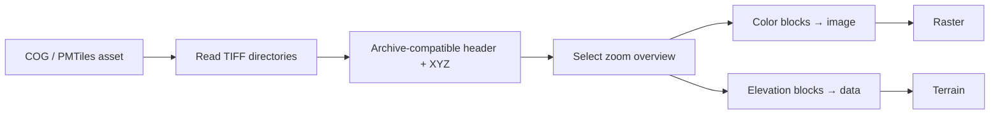

# Cloud Optimized GeoTIFF

[Source guide](../README.md) | [Project README](../../README.md)

Reads supported GeoTIFF metadata and byte ranges and decodes color or elevation
tiles from COG sources. The same source can be used by raster and terrain paths.

## Adapting a COG to tiles

Supports classic TIFF in EPSG:3857, not BigTIFF; requests outside coverage
return no tile. Raster initialization uses a
[worker-backed adapter](../workers/openCogInWorker.js).

- [getCogHeader.js](./getCogHeader.js): obtain COG metadata.
- [getColorTile.js](./getColorTile.js) and [getElevationTile.js](./getElevationTile.js): request tile data.
- [decodeCogTile.js](./decodeCogTile.js): decode compressed tile bytes.

Related: [archives](../archives/README.md), [terrain](../terrain/README.md), [workers](../workers/README.md).
