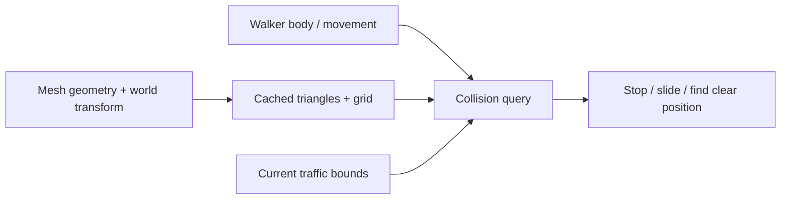

# Collision

[Source guide](../README.md) | [Project README](../../README.md)

Builds and queries collision geometry for movement and spatial intersection.
Mesh colliders cache triangles and a spatial grid; callers use these queries for
walker and traffic interactions.

## Spatial queries

[insideWalker.js](./insideWalker.js) excludes terrain and checks body heights.
This tests current traffic positions; traffic does not steer around the walker.
[Picking](../picking/README.md) resolves pointer hits instead.

- [collider.js](./collider.js): build or reuse a mesh collider.
- [insideWalker.js](./insideWalker.js): test the walker's surroundings.
- [indexTriangle.js](./indexTriangle.js): index a triangle into grid cells.

Related: [walk](../walk/README.md), [picking](../picking/README.md), [traffic](../traffic/README.md).
