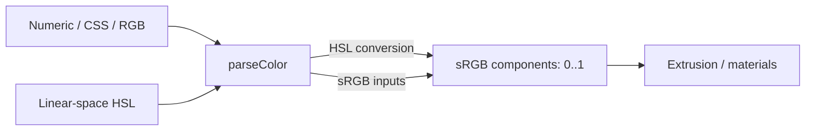

# Colors

[Source guide](../README.md) | [Project README](../../README.md)

Parses and converts colors and provides interpolation and formatting helpers.

## Color-space boundary

CSS strings use the browser parser; CSS alpha is not used for extrusion.
Do not convert the resulting sRGB values a second time.

- [parseColor.js](./parseColor.js): interpret supported color inputs.
- [mixColor.js](./mixColor.js): interpolate colors.
- [toSRGB.js](./toSRGB.js) and [formatRGB.js](./formatRGB.js): convert and format output.

Related: [materials](../materials/README.md), [sunlight](../sunlight/README.md).
