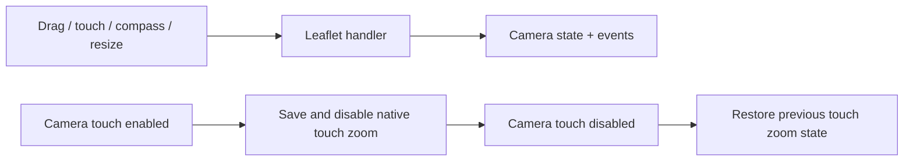

# Controls

[Source guide](../README.md) | [Project README](../../README.md)

Implements camera interaction handlers for dragging, touch, compass and container
resizing, including listener setup and cleanup.

## Input to camera state

[camera](../camera/README.md) validates and owns the angles. Pair add/remove
hooks for listeners and preserve native touch-zoom coordination.

- [cameraControls.js](./cameraControls.js): register camera handlers.
- [dragCamera.js](./dragCamera.js): set up camera dragging.
- [changeCameraTouch.js](./changeCameraTouch.js): manage touch interaction state.

Related: [camera](../camera/README.md), [animations](../animations/README.md).
