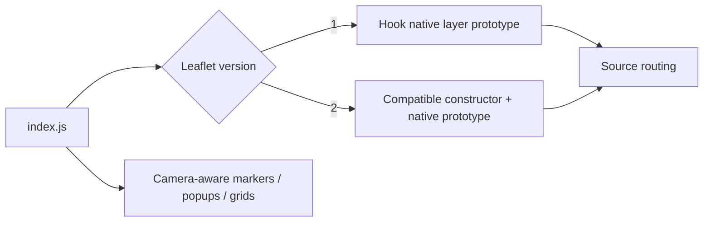

# Leaflet integration

[Source guide](../README.md) | [Project README](../../README.md)

Contains Leaflet compatibility hooks and camera-aware behavior for native map
layers, markers, popups and tooltips. The public entry point installs these hooks.

## Compatibility boundary

The public contract remains `L.Layer`, including `instanceof`.
[whenReady.js](./whenReady.js) returns a registered readiness promise or
resolves immediately when none exists; source errors belong to initializers.

- [constructLayer.js](./constructLayer.js): construct the compatible layer.
- [layerCallInitHooks.js](./layerCallInitHooks.js): coordinate layer initialization hooks.
- [whenReady.js](./whenReady.js): expose asynchronous readiness.

Related: [scene](../scene/README.md), [camera](../camera/README.md), [native](../native/README.md).
