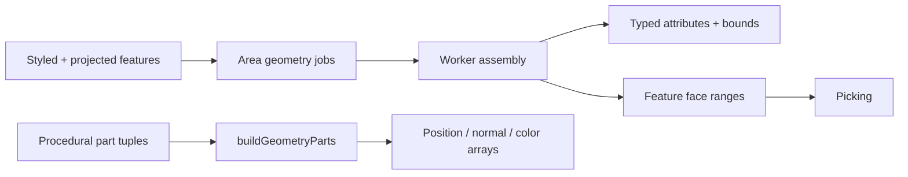

# Geometry

[Source guide](../README.md) | [Project README](../../README.md)

Builds mesh data for source features, terrain, native layers, models and traffic.
Geometry routines use the dedicated projection and triangulation modules.

## Feature geometry pipeline

Half-open ranges identify features without one mesh per triangle; instancing
is used where suitable. Polygon triangulation lives in
[triangulation](../triangulation/README.md); native paths use a separate path.

- [assembleAreaGeometry.js](./assembleAreaGeometry.js): assemble source area geometry.
- [computeBounds.js](./computeBounds.js): compute bounds and radius for geometry.
- [nativeGeometry.js](./nativeGeometry.js): build geometry from native Leaflet paths.

Related: [triangulation](../triangulation/README.md), [projections](../projections/README.md), [rendering](../rendering/README.md).
