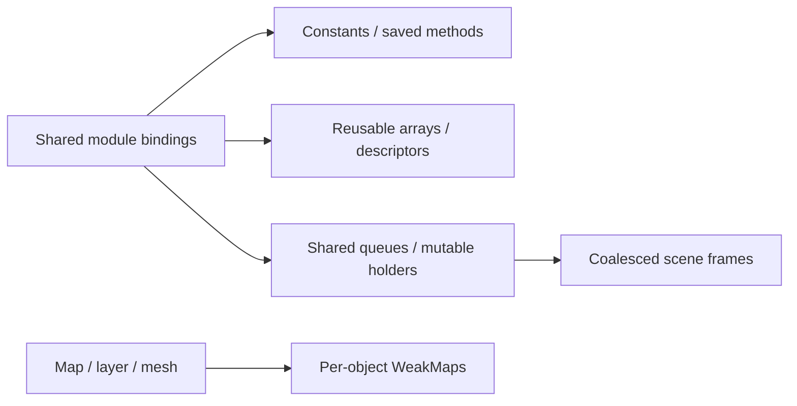

# Shared globals

[Source guide](../README.md) | [Project README](../../README.md)

Holds shared constants, reusable buffers and descriptors, queues and mutable
holders. Each module owns a single shared binding; callers should respect whether
its contents are reusable mutable scratch state or an immutable constant.

## Shared is not per-layer

Scratch values are reused: do not retain them as private layer state. Clear
temporary resource references as existing consumers do. Per-object lifetime
belongs in [weakmaps](../weakmaps/README.md).

- [L.js](./L.js): host Leaflet namespace.
- [geometryWorkerUrl.js](./geometryWorkerUrl.js): default worker URL.
- [pendingUpdates.js](./pendingUpdates.js): queued scene updates.

Related: [weakmaps](../weakmaps/README.md), [scene](../scene/README.md).
