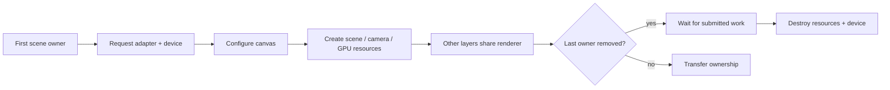

# GPU resources

[Source guide](../README.md) | [Project README](../../README.md)

Requests WebGPU adapters and devices, initializes shared renderer resources and
reports device or shader failures. Rendering operations are in a separate folder.

## Renderer lifetime

Missing WebGPU or canvas context is an attachment error. Cleanup errors are
reported to the layer; see [scene](../scene/README.md) for ownership transfer.

- [initializeSharedRenderer.js](./initializeSharedRenderer.js): create shared renderer state.
- [initializeRendererResources.js](./initializeRendererResources.js): initialize GPU resources.
- [releaseRenderer.js](./releaseRenderer.js): release renderer resources.

Related: [rendering](../rendering/README.md), [materials](../materials/README.md).
