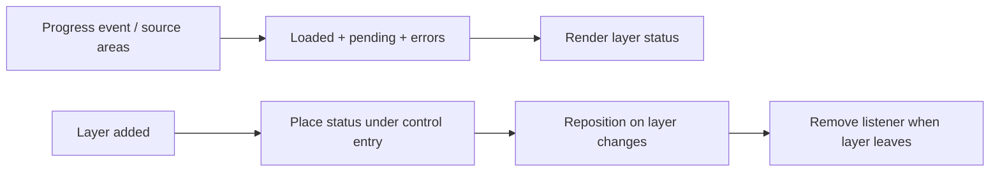

# Layer controls

[Source guide](../README.md) | [Project README](../../README.md)

Manages layer control entry placement and loading or feature-count status.

## Status follows the layer

Status reflects source progress, not GPU frame completion. Placement may fail
when no layers control lists the layer; loading must remain independent of it.

- [placeEntry.js](./placeEntry.js): place a layer entry.
- [updateLayerCount.js](./updateLayerCount.js): update its status.
- [renderLayerCount.js](./renderLayerCount.js): render loading and count information.

Related: [scene](../scene/README.md), [sources](../sources/README.md).
