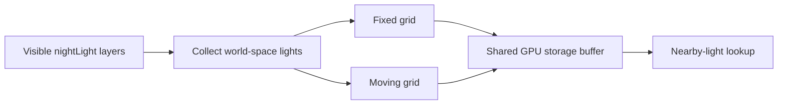

# Lighting

[Source guide](../README.md) | [Project README](../../README.md)

Collects point lights from visible scene layers and maintains spatial grids for
fixed and moving lights. Grid data is uploaded for the shared renderer.

## Point-light grids

Grids use 32-metre cells. If their data exceeds the GPU storage limit, the
update throws; buffer growth also refreshes bindings. Directional sunlight uses
separate [shadows](../shadows/README.md).

- [updatePointLights.js](./updatePointLights.js): collect, cache and upload light grids.
- [lightGrid.js](./lightGrid.js): build a spatial light grid.
- [worldLights.js](./worldLights.js): transform lights into world coordinates.

Related: [shadows](../shadows/README.md), [sunlight](../sunlight/README.md), [rendering](../rendering/README.md).
