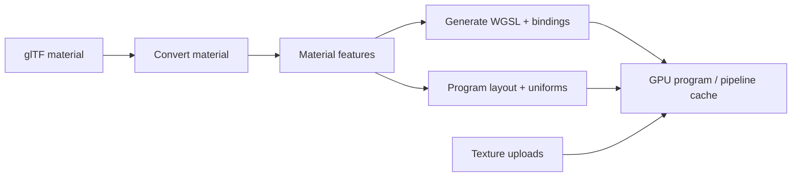

# Materials

[Source guide](../README.md) | [Project README](../../README.md)

Builds GPU material programs, layouts and uniforms, converts model materials,
and handles terrain and roof material requirements.

## Material to GPU program

Shader declarations, binding order, uniforms and mesh attributes must agree.
Compilation diagnostics are reported through [gpu](../gpu/README.md).

- [createProgram.js](./createProgram.js): create a material program.
- [createProgramLayout.js](./createProgramLayout.js): configure GPU bindings.
- [modelMaterialFor.js](./modelMaterialFor.js): derive materials from model data.

Related: [shaders](../shaders/README.md), [textures](../textures/README.md), [rendering](../rendering/README.md).
