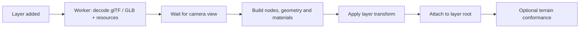

# Models

[Source guide](../README.md) | [Project README](../../README.md)

Loads static GLB/glTF resources, decodes model attributes and builds scene nodes.
Model loading uses a source worker before attaching nodes to the layer.

## Loading and attachment

Missing scenes and empty root lists are errors. For misplaced models, inspect
node and layer [transforms](../transforms/README.md) before projection.

- [loadModel.js](./loadModel.js): load, attach and optionally conform a model to terrain.
- [decodeModel.js](./decodeModel.js): decode model content.
- [buildModelNodes.js](./buildModelNodes.js): assemble model scene nodes.

Related: [workers](../workers/README.md), [materials](../materials/README.md), [transforms](../transforms/README.md).
