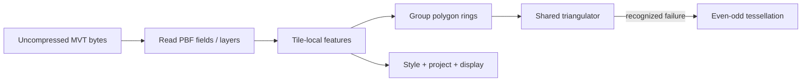

# Mapbox Vector Tiles

[Source guide](../README.md) | [Project README](../../README.md)

Decodes uncompressed MVT/PBF data into tile-local layers and provides polygon
ring triangulation. Large integer values are preserved as decimal strings.

## Tile-space decoding

Duplicate layer names are rejected. Integers outside JavaScript's safe range
are decimal strings, including possible IDs and properties. Presentation
belongs to [vector-tiles](../vector-tiles/README.md).

- [decodeVectorTile.js](./decodeVectorTile.js): decode a tile.
- [readMvtLayer.js](./readMvtLayer.js): read a layer from the PBF stream.
- [triangulateVectorRings.js](./triangulateVectorRings.js): tessellate polygon rings.

Related: [vector-tiles](../vector-tiles/README.md), [vector-style](../vector-style/README.md).
