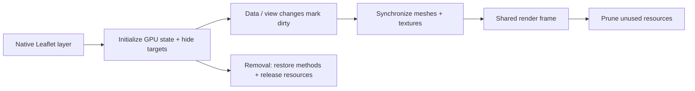

# Native Leaflet layers

[Source guide](../README.md) | [Project README](../../README.md)

Synchronizes supported Leaflet layers with GPU meshes and textures, forwards
events and restores original methods and DOM targets on disposal.

## Leaflet source and GPU representation

Leaflet remains the source of data and events; GPU objects are a representation.
Pair wrapped methods, listeners and cached resources with their disposal path.
Native paths are clipped to streamed raster coverage and split along the
terrain grid's triangle edges before sampling their elevation. This also drapes
long segments, fills and stroke widths over slopes, rather than only lifting
the original track points. A one-metre offset limits z-fighting. Terrain paths
rebuild on zoom instead of reusing flat stroke anchors.
During zoom, elevation sampling and subdivision follow rendered terrain meshes,
including retained outgoing levels, before consulting the raw DEM cache. This
keeps paths on the displayed surface while replacement tiles are loading.
An outgoing zoom level is replaced only when the incoming visible tiles have
both imagery and terrain. Levels are not overlapped: a higher outgoing surface
would otherwise occlude paths already draped on the replacement. `terrainchange`
is emitted after the new meshes are installed and outgoing meshes are pruned.
[nativeTerrainRequest.js](./nativeTerrainRequest.js) selects rendered coverage;
[nativeTerrainElevation.js](./nativeTerrainElevation.js) interpolates its surface.
[syncGridLayer.js](./syncGridLayer.js) gates zoom-level replacement on imagery,
fade and DEM readiness before synchronizing individual loaded tiles.
Terrain heights are absolute scene metres: subtract the root's vertical offset
and divide by its vertical scale before storing local vertices, as for paths
and markers. A basemap created at a different latitude must not scale DEM heights.

- [initNativeGPU.js](./initNativeGPU.js): start native GPU initialization.
- [synchronizeNativeLayer.js](./synchronizeNativeLayer.js): synchronize dirty layer state.
- [disposeNativeLayer.js](./disposeNativeLayer.js): restore methods and release resources.

Related: [core](../core/README.md), [rendering](../rendering/README.md), [picking](../picking/README.md).
