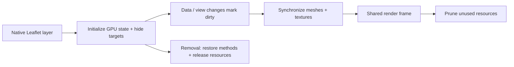

# Native Leaflet layers

[Source guide](../README.md) | [Project README](../../README.md)

Synchronizes supported Leaflet layers with GPU meshes and textures, forwards
events and restores original methods and DOM targets on disposal.

## Leaflet source and GPU representation

Leaflet remains the source of data and events; GPU objects are a representation.
Pair wrapped methods, listeners and cached resources with their disposal path.

- [initNativeGPU.js](./initNativeGPU.js): start native GPU initialization.
- [synchronizeNativeLayer.js](./synchronizeNativeLayer.js): synchronize dirty layer state.
- [disposeNativeLayer.js](./disposeNativeLayer.js): restore methods and release resources.

Related: [core](../core/README.md), [rendering](../rendering/README.md), [picking](../picking/README.md).
