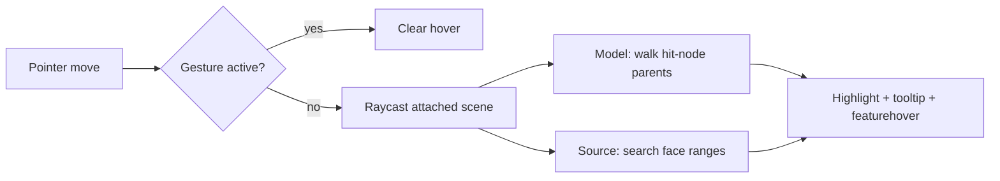

# Picking

[Source guide](../README.md) | [Project README](../../README.md)

Converts pointer events into scene raycasts, feature hits, hover highlighting and
tooltips. Model hits and batched source features are resolved differently.

## Pointer to feature

Face ranges come from [geometry](../geometry/README.md); keep them aligned
with triangle order. A missing hit may also mean the root or camera is not
attached.

- [raycast.js](./raycast.js): intersect a pointer ray with scene meshes.
- [findFeature.js](./findFeature.js): resolve an intersection to a feature.
- [onPointerMove.js](./onPointerMove.js): update pointer interaction.

Related: [collision](../collision/README.md), [native](../native/README.md), [scene](../scene/README.md).
