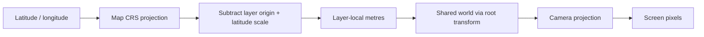

# Projections

[Source guide](../README.md) | [Project README](../../README.md)

Converts coordinates between geographic, map pixel, screen and local scene
spaces, including camera pitch and bearing.

## Coordinate spaces

Local coordinates use positive X east and negative Z north. Screen/ground
conversion depends on pitch, bearing and view. Do not mix degrees, pixels,
layer-local metres and shared-world coordinates.

- [localPosition.js](./localPosition.js): compute a local scene position.
- [projectCameraPoint.js](./projectCameraPoint.js): project a camera-aware point.
- [groundBounds.js](./groundBounds.js): compute visible ground bounds.

Related: [camera](../camera/README.md), [geometry](../geometry/README.md), [transforms](../transforms/README.md).
