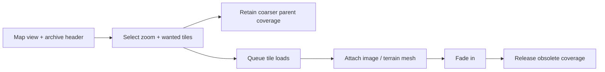

# Raster

[Source guide](../README.md) | [Project README](../../README.md)

Selects, loads and retains raster tiles for the current view, creating meshes
and optionally attaching imagery to terrain. Parent tiles provide interim coverage.

## View-driven tile lifecycle

Fallback tiles remain while wanted tiles are pending or fading; horizon views
are capped at 169 tiles. Loading emits tile and loading events.
[COG](../cog/README.md) uses an archive-compatible adapter.

- [initRaster.js](./initRaster.js): initialize a raster layer.
- [updateRasterTiles.js](./updateRasterTiles.js): select wanted and fallback tiles.
- [pruneRasterTiles.js](./pruneRasterTiles.js): release tiles no longer needed.

Related: [archives](../archives/README.md), [cog](../cog/README.md), [terrain](../terrain/README.md), [textures](../textures/README.md).
