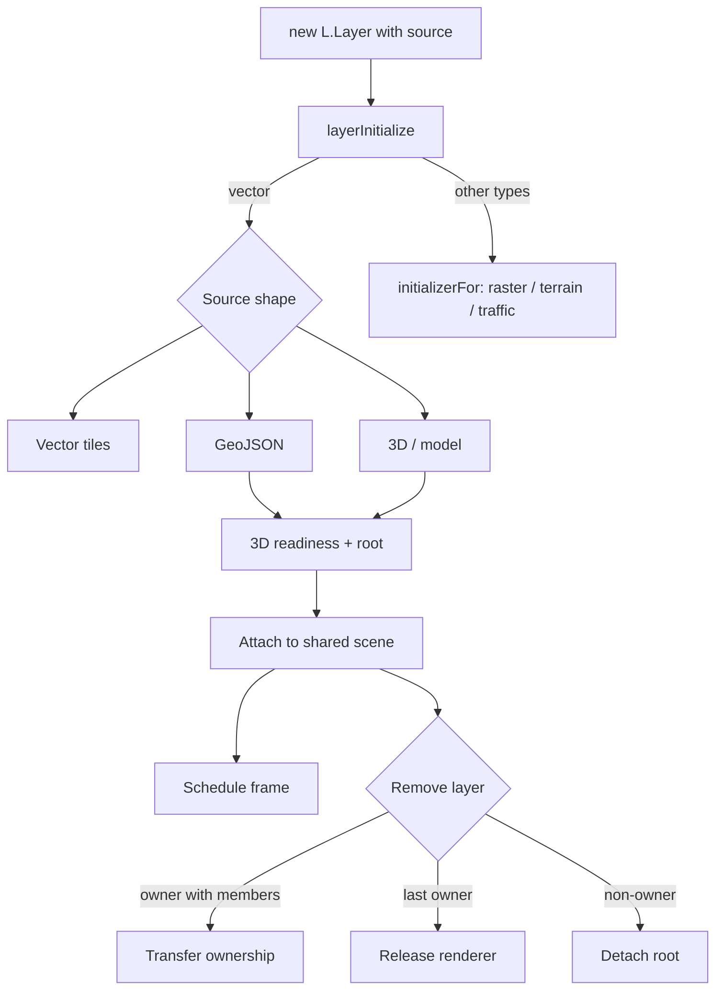

# Scene and layer lifecycle

[Source guide](../README.md) | [Project README](../../README.md)

Routes layer source options to their implementations and manages attachment,
shared renderer ownership, updates and scene graph nodes.

## Layer lifecycle

Source settings are flattened; omitted types are inferred as described in
[index.js](../index.js). Addition and readiness may occur in either order.
The [removal path](./onRemove3DLayer.js) cancels areas before detaching.

- [layerInitialize.js](./layerInitialize.js): choose vector handling or queue other source types.
- [initializerFor.js](./initializerFor.js): select raster, terrain or traffic initialization.
- [attachSharedScene.js](./attachSharedScene.js): attach a layer to a shared scene.

Related: [sources](../sources/README.md), [gpu](../gpu/README.md), [weakmaps](../weakmaps/README.md).
