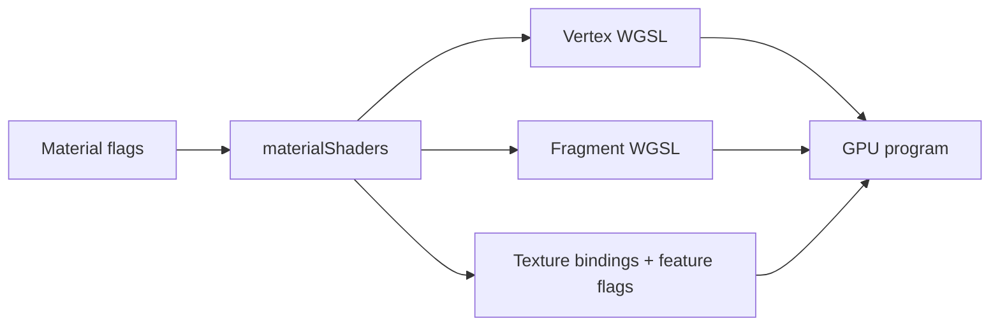

# Shaders

[Source guide](../README.md) | [Project README](../../README.md)

Generates WGSL shader code for materials, native strokes and roof projection.
Material program setup and GPU resource binding live outside this folder.

## Generated variants

Generation does not require a GPU. Binding order, material layout, uniform
writes and vertex attributes must agree; compilation diagnostics come from
[gpu](../gpu/README.md).

- [materialShaders.js](./materialShaders.js): assemble material shader variants.
- [materialVertexShader.js](./materialVertexShader.js): generate vertex shader code.
- [materialBaseShader.js](./materialBaseShader.js): generate material fragment logic.

Related: [materials](../materials/README.md), [textures](../textures/README.md), [rendering](../rendering/README.md).
