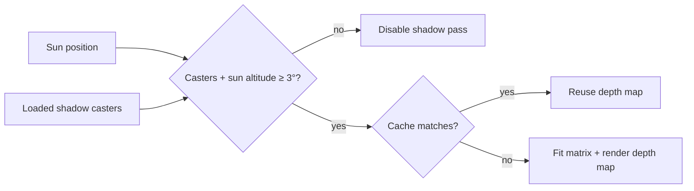

# Shadows

[Source guide](../README.md) | [Project README](../../README.md)

Creates and renders directional sunlight shadow maps, with cached camera and
mesh state to avoid unnecessary redraws.

## Shadow pass and cache

Loaded off-screen geometry can cast shadows. Cache snapshots include direction,
world versions, geometry and draw ranges: changes affecting shadows must
invalidate the cache. Point lights are separate.

- [renderSunlight.js](./renderSunlight.js): update sunlight shadow rendering.
- [shadowMatrix.js](./shadowMatrix.js): fit the shadow camera to scene bounds.
- [ensureShadowPipeline.js](./ensureShadowPipeline.js): prepare shadow GPU pipelines.

Related: [lighting](../lighting/README.md), [sunlight](../sunlight/README.md), [rendering](../rendering/README.md).
