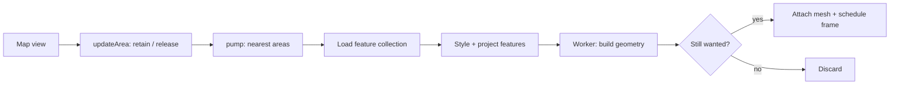

# Vector sources

[Source guide](../README.md) | [Project README](../../README.md)

Initializes GeoJSON and vector tile sources and manages source areas, feature
preparation, loading queues and mesh attachment.

## From view to mesh

GeoJSON uses one area; archive blocks include a view border. The
[pump](./pumpSourceAreas.js) allows four jobs per scene and two per layer.
`null` styles skip features; metadata and face ranges support
[picking](../picking/README.md). Errors emit `error`; released areas abort
work and destroy their buffers. [Vector tiles](../vector-tiles/README.md) have
a separate lifecycle.

- [initializeGeoJSON.js](./initializeGeoJSON.js): initialize a GeoJSON-backed layer.
- [updateArea.js](./updateArea.js): maintain the areas needed by the view.
- [buildArea.js](./buildArea.js): load features, build worker geometry and attach the mesh.

Related: [scene](../scene/README.md), [workers](../workers/README.md), [vector-tiles](../vector-tiles/README.md).
