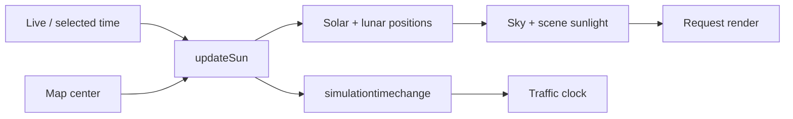

# Sunlight and time controls

[Source guide](../README.md) | [Project README](../../README.md)

Integrates sunlight and a time control with Leaflet. Time and map position
determine the sun, moon and sky state used by the scene.

## Clock to scene

Astronomical calculations live in [astronomy](../astronomy/README.md);
[shadows](../shadows/README.md) pause below the low-sun threshold.

- [initSunlight.js](./initSunlight.js): install sunlight and time control integration.
- [updateSun.js](./updateSun.js): update celestial positions and sky state.
- [initializeTimeControl.js](./initializeTimeControl.js): set up the time control.

Related: [astronomy](../astronomy/README.md), [lighting](../lighting/README.md), [shadows](../shadows/README.md).
