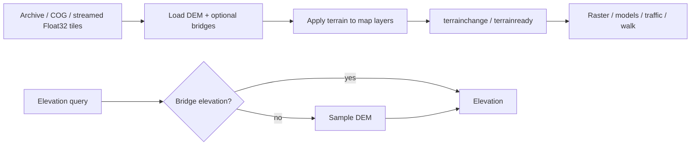

# Terrain

[Source guide](../README.md) | [Project README](../../README.md)

Loads elevation tiles and optional bridge data, applies terrain to the map and
provides elevation sampling for other layers and interactions.

## Elevation lifecycle

Streamed tiles are 256 pixels. [getElevation.js](./getElevation.js) returns
`null` when unavailable, not an actual zero. Removal aborts requests and
releases terrain resources.

- [initTerrain.js](./initTerrain.js): configure an archive, COG or streamed terrain source.
- [loadTerrain.js](./loadTerrain.js): load archive terrain and bridge data.
- [getElevation.js](./getElevation.js): sample the ready DEM or bridge elevation.

Related: [cog](../cog/README.md), [raster](../raster/README.md), [geometry](../geometry/README.md).
