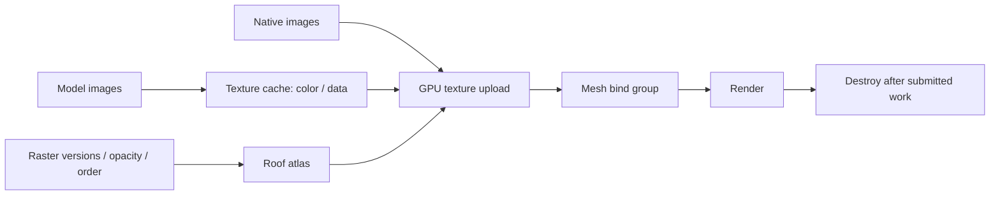

# Textures

[Source guide](../README.md) | [Project README](../../README.md)

Manages image uploads and GPU textures for scene meshes, models and native
layers, including the raster atlas used for roofs.

## Upload, reuse and release

Atlas rebuilds are throttled while tiles load. Binding changes trigger a bind
group rebuild; resource destruction must wait for submitted GPU work.

- [prepareMeshTextures.js](./prepareMeshTextures.js): prepare textures for a mesh.
- [modelTextureFor.js](./modelTextureFor.js): create or reuse a model texture.
- [updateRoofAtlas.js](./updateRoofAtlas.js): refresh the roof atlas when raster layers change.

Related: [materials](../materials/README.md), [raster](../raster/README.md), [native](../native/README.md).
