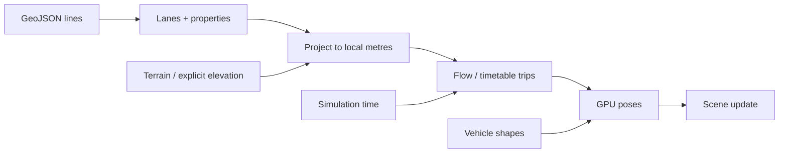

# Traffic

[Source guide](../README.md) | [Project README](../../README.md)

Loads traffic lanes and schedules trips for vehicles and pedestrians, updating
their poses in the shared GPU scene as simulation time advances.

## Lane data to moving objects

New lane loads abort the previous request; live time schedules further frames.
Collision queries use current traffic bounds, but traffic does not steer around
the walker. Timetables use their configured time zone.

- [initTraffic.js](./initTraffic.js): configure a traffic layer.
- [loadTraffic.js](./loadTraffic.js): request lanes for the current time.
- [tickTraffic.js](./tickTraffic.js): refresh trips and poses.

Related: [vehicles](../vehicles/README.md), [sunlight](../sunlight/README.md), [terrain](../terrain/README.md).
