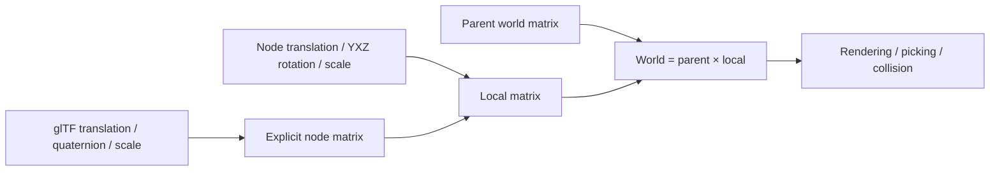

# Transforms

[Source guide](../README.md) | [Project README](../../README.md)

Composes model and scene transforms and updates world matrices when nodes or
their parents change.

## Local to world

An explicit matrix overrides node components. Unchanged matrices are not
recomputed, but children are still visited. Geographic projection is separate.

- [composeLocalTransform.js](./composeLocalTransform.js): compose translation, rotation and scale.
- [updateWorldMatrix.js](./updateWorldMatrix.js): update a scene subtree.
- [modelNodeMatrix.js](./modelNodeMatrix.js): derive model node transforms.

Related: [scene](../scene/README.md), [models](../models/README.md), [projections](../projections/README.md).
