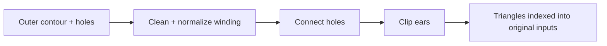

# Triangulation

[Source guide](../README.md) | [Project README](../../README.md)

Triangulates polygon contours and holes, cleaning rings and normalizing their
winding while retaining indices into the original input vertices.

## Polygon to triangles

Input rings omit the repeated closing vertex. Indices still refer to the
original contour followed by holes after cleanup; preserve that contract.
[MVT](../mvt/README.md) has a separate fallback for quantized rings.

- [triangulate.js](./triangulate.js): triangulate a polygon.
- [polygonRings.js](./polygonRings.js): clean and normalize rings.
- [clipEars.js](./clipEars.js): generate triangles by ear clipping.

Related: [geometry](../geometry/README.md), [mvt](../mvt/README.md).
