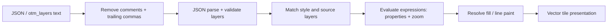

# Vector styles

[Source guide](../README.md) | [Project README](../../README.md)

Parses and validates vector style layers, evaluates supported expressions and
translates paint values for vector tile rendering.

## Style input and evaluation

Parsing does not execute arbitrary JavaScript. Only supported expression
operators are evaluated; non-array values pass through unchanged.

- [parseVectorStyle.js](./parseVectorStyle.js): parse and validate style source.
- [evaluateStyle.js](./evaluateStyle.js): evaluate style expressions.
- [vectorPaint.js](./vectorPaint.js): derive paint values.

Related: [vector-tiles](../vector-tiles/README.md), [colors](../colors/README.md), [mvt](../mvt/README.md).
