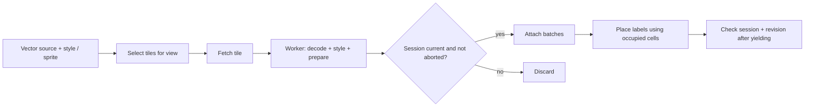

# Vector tiles

[Source guide](../README.md) | [Project README](../../README.md)

Configures vector tile layers, loads and prepares tiles, and manages their
paint, labels and lifecycle as the view changes.

## Tile and label lifecycle

The public layer remains a `vector` source. Stale sessions must neither attach
results nor decrement a new session's in-flight count. Label revisions prevent
older placement work from replacing a newer view.

- [configureVectorTileLayer.js](./configureVectorTileLayer.js): configure layer lifecycle.
- [loadVectorTile.js](./loadVectorTile.js): fetch and attach a tile.
- [updateVectorTileLabels.js](./updateVectorTileLabels.js): update visible labels.

Related: [mvt](../mvt/README.md), [vector-style](../vector-style/README.md), [workers](../workers/README.md).
