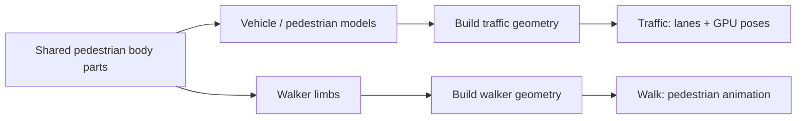

# Vehicle models

[Source guide](../README.md) | [Project README](../../README.md)

Creates procedural vehicle and pedestrian parts for traffic. Walking uses
shared pedestrian body parts rather than the traffic model itself.

## Shapes versus movement

These are shapes, not animated layers. Shared-part changes affect both
consumers; changes here do not alter traffic routing or walker movement.

- [carModel.js](./carModel.js): construct car parts.
- [pedestrianModel.js](./pedestrianModel.js): construct pedestrian parts.
- [bicycleModel.js](./bicycleModel.js): construct bicycle parts.

Related: [traffic](../traffic/README.md), [walk](../walk/README.md), [geometry](../geometry/README.md).
