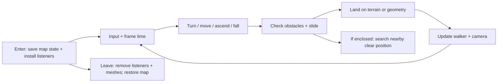

# Walk mode

[Source guide](../README.md) | [Project README](../../README.md)

Provides a third-person walking control, including input, walker animation,
terrain following, camera updates and movement collision checks.

## Enter, move, leave

Movement checks current obstacles but does not make traffic avoid the walker.
Pair any new walk-mode state or listener with
[stopWalking.js](./stopWalking.js).

- [initWalk.js](./initWalk.js): install the walk control.
- [moveWalker.js](./moveWalker.js): move and slide along obstacles.
- [resolveWalkerPosition.js](./resolveWalkerPosition.js): find a clear nearby position when enclosed.

Related: [collision](../collision/README.md), [camera](../camera/README.md), [vehicles](../vehicles/README.md).
