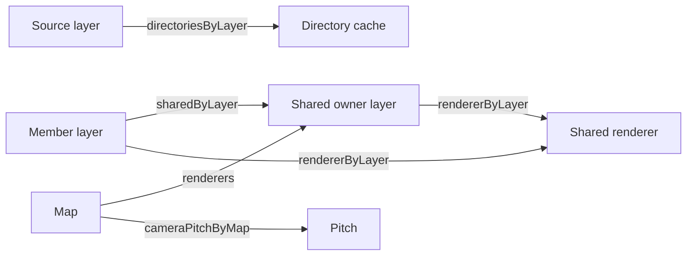

# Private state

[Source guide](../README.md) | [Project README](../../README.md)

Stores state associated with layers, maps and other objects in dedicated
WeakMap modules. Field indexes group maps for lifecycle and compatibility.

## Ownership

Each label names a dedicated `WeakMap` imported directly by its consumers.
Keys can also be meshes or devices. `get` returning `undefined` differs from a
stored `null`.

On owner removal, [onRemove3DLayer.js](../scene/onRemove3DLayer.js) transfers
selected fields or releases the last shared scene. Weak keys do **not** abort
requests, remove listeners or destroy GPU resources.

[sceneFields.js](./sceneFields.js) indexes selected maps for lifecycle and test
compatibility; [cameraFields.js](./cameraFields.js) is a test compatibility
index. They reference the original maps, not copies. When adding state, use a
dedicated module and update indexes and lifecycle lists only where applicable.

Related: [scene](../scene/README.md), [camera](../camera/README.md), [globals](../globals/README.md).
