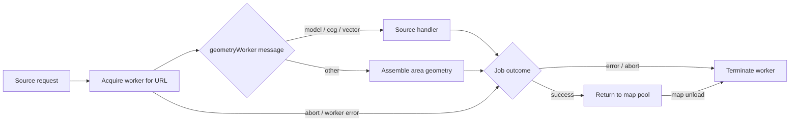

# Workers

[Source guide](../README.md) | [Project README](../../README.md)

Coordinates the shared geometry worker pool and handles source tasks away from
the main thread, including model, COG, vector tile and area geometry work.

## Request and lifetime

[runSourceWorker.js](./runSourceWorker.js) removes job listeners on completion.
Transferred buffers are no longer usable on the sending side. Callers must
check cancellation or session freshness before attaching results; vector tiles
also have their own [session lifecycle](../vector-tiles/README.md).

- [geometryWorker.js](./geometryWorker.js): dispatch worker requests.
- [runSourceWorker.js](./runSourceWorker.js): submit source work.
- [buildAreaInWorker.js](./buildAreaInWorker.js): build source area geometry.

Related: [sources](../sources/README.md), [models](../models/README.md), [cog](../cog/README.md), [vector-tiles](../vector-tiles/README.md).
