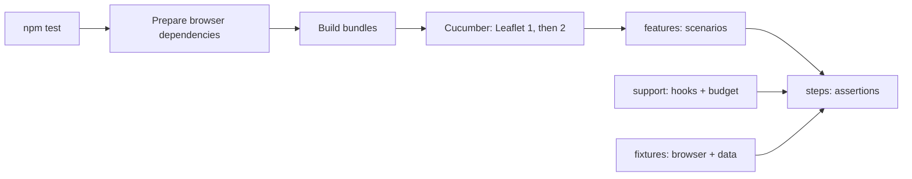

# Test guide

[Project README](../README.md) | [Source guide](../src/README.md)

The suite uses Cucumber scenarios and step definitions. The normal runner
builds the project and tests Leaflet 1 and 2.



## Run and select

```sh
npm test
npx cucumber-js --name '^Repository directories satisfy README requirements$' --format summary
```

The second command runs Cucumber directly: it does not perform the build or
download the browser dependency cache. `--name` filters the configured feature
glob; adding a feature path on the command line does **not** replace that glob.
For a selected run through the build and both Leaflet versions, pass the same
filter to `npm test -- --name '...'`.

Default runs omit `@unit` and `@smoke` on Leaflet 2 because they already ran
with Leaflet 1; custom selections omit only `@smoke` for Leaflet 2. See
[build/test.js](../build/test.js) and [CI](../.github/workflows/ci.yml).

## Find your way

Smoke tests use the development server's CDN rewriting (`watch: true`), not
browser interception of plugin assets. A focused scenario checks served HTML,
unchanged example files and local asset contents; browser checks reject requests
for this package on the CDN.

- [features](./features/README.md): scenarios, tags and behavior.
- [steps](./steps/README.md): assertions and scenario code.
- [fixtures](./fixtures/README.md): deterministic data and browser environment.
- [support](./support/README.md): setup, cleanup and scenario time budget.

Add a README to every new non-ignored directory, including nested directories,
except `.github`, `examples` and their descendants, which must not contain README files. The
[documentation scenarios](./features/source-documentation.feature) enforce this.
