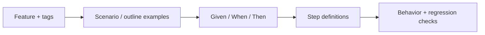

# Features

[Test guide](../README.md) | [Project README](../../README.md)

Gherkin files describe observable behavior; each step is implemented in
[steps](../steps/README.md). Cucumber loads all `*.feature` files recursively.

- `@unit` scenarios do not require a browser page; global setup still runs.
- `@coverage` scenarios that are not `@unit` require WebGPU; coverage
  collection is enabled with `COVERAGE_3D`.
- `@smoke` checks examples using its own browser setup.

Find scenarios by domain, for example [scene](./scene.feature),
[workers](./workers.feature), [walk](./walk.feature), or
[source documentation](./source-documentation.feature). Use distinct
scenario names for focused `--name` runs. See the [test guide](../README.md)
for commands and version selection.
