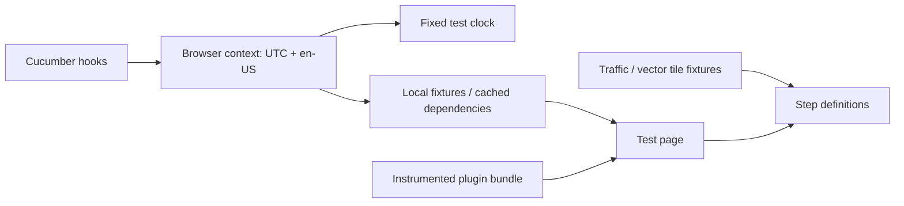

# Test fixtures

[Test guide](../README.md) | [Project README](../../README.md)

Fixtures supply deterministic browser state, data and access to instrumented
source modules; scenario lifecycle is managed by [support](../support/README.md).

[browser-environment.js](./browser-environment.js) blocks unexpected external
requests and resets reused contexts. [dependencies.js](./dependencies.js)
maps known CDN URLs to a local cache; `npm test` prepares missing files.
[plugin.js](./plugin.js) exposes test operations and source helpers, while
[globals.js](./globals.js) bridges private state for tests.

Use focused data such as [focused-paris.js](./focused-paris.js) to retain the
real layers relevant to a scenario without loading unrelated ones.
