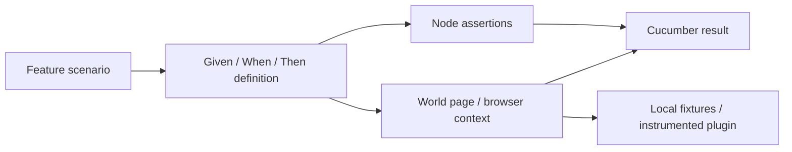

# Step definitions

[Test guide](../README.md) | [Project README](../../README.md)

Step definitions connect Gherkin to Node assertions and, where needed,
Playwright browser interactions.

Start with the matching [feature](../features/README.md) and its domain's
`*.steps.js` file. Reuse [fixtures](../fixtures/README.md) and the existing
world rather than adding network-dependent setup. Examples:
[workers.steps.js](./workers.steps.js),
[walk.steps.js](./walk.steps.js), and
[source-documentation.steps.js](./source-documentation.steps.js).

Setup and steps share a 30-second scenario budget. Split independent checks
instead of increasing timeouts; cleanup is exempt. See
[scenario-budget.js](../support/scenario-budget.js).
