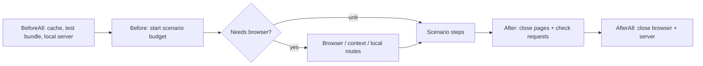

# Test support

[Test guide](../README.md) | [Project README](../../README.md)

Hooks provide global setup, scenario context and cleanup for Cucumber.

[hooks.js](./hooks.js) creates the browser lazily for ordinary browser
scenarios; `@smoke` has separate setup. Non-unit `@coverage` scenarios require
WebGPU. On Linux CI the shared setup checks WebGPU using SwiftShader.

[scenario-budget.js](./scenario-budget.js) gives setup and steps one shared
30-second deadline. Global hooks and cleanup are exempt; split independent
checks instead of increasing the budget. The hooks also report the slowest
scenarios, including setup and cleanup.
